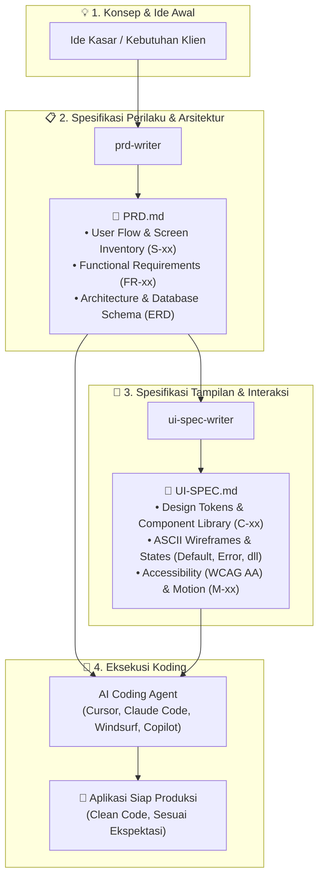

# 👻 Phantom Skills — Universal AI Agent Skills Suite

[](https://github.com/vercel-labs/agent-skills)
[](https://opensource.org/licenses/MIT)
[](#-koleksi-skills)
[](#-alur-kerja-spec-driven-development)
[](#)

**Phantom Skills** adalah kumpulan *custom skills* modular dan universal berstandar terbuka untuk berbagai **AI Code Agent** (Cursor, Claude Code, Windsurf, Cline, Roo Code, GitHub Copilot, Gemini CLI, dan Antigravity).

Phantom Skills menerapkan metodologi **Spec-Driven Development (SDD)**: mengubah ide kasar menjadi blueprint teknis dan desain antarmuka yang presisi sebelum satu baris kode pun ditulis. Dengan pemisahan tegas antara **perilaku produk (*behavior*)** dan **tampilan visual (*appearance/interaction*)**, agen koding Anda dapat mengeksekusi proyek dengan tingkat akurasi tinggi tanpa halusinasi (*zero guesswork*).

---

## 🔄 Alur Kerja Spec-Driven Development



---

## 📦 Koleksi Skills

Repositori ini memuat 2 *skill* utama yang saling melengkapi namun dapat digunakan secara mandiri:

### 1. 📋 `prd-writer` — Universal PRD & Technical Spec
> **Fokus:** Menjadi *Single Source of Truth* untuk **perilaku, kebutuhan sistem, arsitektur, dan logika produk**.

* **Alur Clarify-then-Generate:** Menganalisis ide Anda dan mengajukan 3–5 pertanyaan tajam sesuai arketipe proyek (SaaS, Mobile, 3D/Motion Web, AI Agent, Game, CLI, Marketplace), atau langsung dieksekusi dengan opsi *"buat langsung"*.
* **Diagram Visual Otomatis (Mermaid):** Menghasilkan *User Flowchart*, *Architecture Diagram*, dan *Database ER Diagram* yang siap di-render di IDE, GitHub, maupun Notion.
* **Traceable & Stable IDs:** Setiap kebutuhan (`FR-xx`, `NFR-xx`), fitur (`F-xx`), dan layar (`S-xx`) memiliki identitas permanen untuk integrasi ke tahap desain.
* **Output:** Dokumen `PRD.md` 7 poin terstruktur lengkap dengan kriteria penerimaan terukur (*Given/When/Then*).

---

### 2. 🎨 `ui-spec-writer` — Developer & Designer-Ready UI Specification
> **Fokus:** Menjadi *Single Source of Truth* untuk **estetika, sistem desain, interaksi, dan spesifikasi layar per layar**.

* **Kontrak Ketat dengan PRD (Non-Destructive):** Bersifat *read-only* terhadap `PRD.md`. Tidak pernah mengubah logika bisnis di PRD secara sepihak; jika ada celah desain, dicatat dalam *PRD Change Requests*.
* **Arah Visual Anti-Generic:** Memandu arah visual unik berbasis domain industri, menjauh dari *AI template defaults* (anti-generic checklist).
* **Desain Sistem & Token Mandiri:** Mendefinisikan token warna (peran semantik), tipografi, spacing, radius, elevasi, serta pustaka komponen (`C-xx`) dengan varian dan status interaksi.
* **Spesifikasi Layar Komprehensif:** ASCII Wireframe responsif (mobile & desktop) dengan cakupan status lengkap (*default, loading, empty, error, success, offline*).
* **Aksesibilitas & Microcopy:** Standar kontras WCAG AA (4.5:1 / 3:1), target sentuh ≥44×44px, navigasi keyboard, serta kurasi teks tombol dan pesan error bernada aktif.
* **Output:** Dokumen `UI-SPEC.md` 11 bagian yang siap diserahkan langsung ke *frontend developer* atau *coding agent*.

---

## 📑 Perbandingan Output: `PRD.md` vs `UI-SPEC.md`

| Aspek | `PRD.md` (`prd-writer`) | `UI-SPEC.md` (`ui-spec-writer`) |
| :--- | :--- | :--- |
| **Fokus Utama** | Perilaku (*What it does & why*) | Tampilan & Rasa (*How it looks & feels*) |
| **Pondasi Dasar** | Ide kasar / deskripsi kebutuhan user | Dokumen `PRD.md` yang sudah ada |
| **Identitas Elemen** | `FR-xx` (Req), `F-xx` (Feature), `S-xx` (Screen) | Merujuk `F-xx` & `S-xx`, membuat `C-xx` & `M-xx` |
| **Diagram** | User Flow, Architecture, ERD | Sitemap / Navigasi Antar-Layar |
| **Representasi Visual**| Screen Inventory (nama & peran layar) | ASCII Wireframe (Mobile & Desktop) |
| **Sistem Desain** | Rekomendasi Tech Stack & Library | Design Tokens (Color Hex, Spacing, Radius) |
| **States** | Edge cases & validasi logika bisnis | 5+ UI States (Default, Loading, Empty, Error, Success) |
| **Standar Kualitas** | Given/When/Then Acceptance Criteria | WCAG AA, Touch Targets, Microcopy, Motion Curves |

---

## 🚀 Cara Instalasi

Anda dapat menginstal seluruh *skill* sekaligus atau memilih *skill* tertentu ke proyek maupun komputer Anda menggunakan CLI resmi `npx skills`:

### 1. Instal Seluruh Skill (Rekomendasi)
Pasang seluruh paket Phantom Skills ke folder proyek aktif Anda:

```bash
npx skills add https://github.com/chandrapratamalab/phantom-skill.git
```

### 2. Instal Skill Spesifik
Jika Anda hanya membutuhkan salah satu *skill*:

```bash
# Hanya PRD Writer
npx skills add https://github.com/chandrapratamalab/phantom-skill.git --skill prd-writer

# Hanya UI Spec Writer
npx skills add https://github.com/chandrapratamalab/phantom-skill.git --skill ui-spec-writer
```

### 3. Instalasi Khusus Code Agent Tertentu
Gunakan flag `-a` untuk menargetkan agen spesifik:

```bash
# Contoh untuk Cursor dan Claude Code
npx skills add https://github.com/chandrapratamalab/phantom-skill.git -a cursor -a claude-code

# Contoh untuk Windsurf
npx skills add https://github.com/chandrapratamalab/phantom-skill.git -a windsurf
```

### 4. Instalasi Global (Aktif di Semua Proyek Komputer Anda)
Gunakan flag `-g` agar *skills* selalu tersedia di mana pun Anda membuka terminal:

```bash
npx skills add https://github.com/chandrapratamalab/phantom-skill.git -g
```

---

## 💻 Code Agent yang Didukung

| Code Agent | Direktori Instalasi Otomatis | Cara Memanggil / Menjalankan |
| :--- | :--- | :--- |
| **Cursor** | `.cursor/rules/` atau `.agents/skills/` | Otomatis via Chat atau sebut `@prd-writer` / `@ui-spec-writer` |
| **Claude Code** | `.claude/skills/` | Otomatis terdeteksi atau panggil `/prd-writer` / `/ui-spec-writer` |
| **Windsurf** | `.windsurf/rules/` atau `.agents/skills/` | Otomatis di Cascade saat merencanakan arsitektur atau desain UI |
| **Cline / Roo Code** | `.clinerules/` atau `.agents/skills/` | Otomatis aktif saat meminta pembuatan dokumen PRD / UI Spec |
| **GitHub Copilot** | `.github/skills/` | Otomatis aktif pada Copilot Chat & Edits |
| **Google Antigravity** | `.agents/skills/` atau `skills/` | Otomatis aktif sesuai konfigurasi *custom skills* |

---

## 🛠️ Panduan Penggunaan & Contoh Prompt

### Skenario A: Merancang Spesifikasi Produk (`prd-writer`)

Buka chat *agent* Anda dan berikan ide awal aplikasi:

> **Contoh Prompt 1 (SaaS / Web App):**
> *"Gunakan prd-writer untuk merancang aplikasi booking dan antrean barbershop berbasis web dengan notifikasi WhatsApp."*

> **Contoh Prompt 2 (3D Landing Page):**
> *"Buatkan PRD: Landing page interaktif 3D untuk brand jam tangan mewah menggunakan Three.js dan GSAP."*

**Respon Agen:**
Agen akan mengajukan 3–5 pertanyaan klarifikasi singkat (atau langsung menyusun dokumen jika Anda menambahkan instruksi *"buat langsung"*). Hasilnya berupa file `PRD.md` yang siap dieksekusi.

---

### Skenario B: Merancang Desain Antarmuka (`ui-spec-writer`)

Setelah `PRD.md` tersedia di *workspace*, minta agen merancang cetak biru antarmukanya:

> **Contoh Prompt 1:**
> *"Dari PRD.md yang ada, buatkan UI-SPEC.md lengkap dengan design system dan wireframe setiap screen."*

> **Contoh Prompt 2 (Instruksi Cepat):**
> *"Jalankan ui-spec-writer untuk PRD ini. Buat langsung dengan gaya modern, minimalis, dan dark mode."*

**Respon Agen:**
Agen membaca `PRD.md`, menyusun arah visual, menentukan token warna dan tipografi, menggambar diagram navigasi sitemap, merinci ASCII wireframe untuk setiap `S-xx`, serta menyiapkan status layar dan panduan aksesibilitas WCAG AA ke dalam file `UI-SPEC.md`.

---

### Skenario C: Eksekusi Koding Bersama Agen

Setelah Anda memiliki `PRD.md` dan `UI-SPEC.md`:

> **Contoh Prompt Koding:**
> *"Berdasarkan PRD.md (F-01) dan UI-SPEC.md (S-01, C-01), buatkan komponen Header dan Hero Section lengkap dengan animasi dan responsiveness sesuai spesifikasi token."*

Agen Anda akan menulis kode dengan presisi tinggi tanpa perlu menebak warna hex, ukuran tombol, alur navigasi, maupun penanganan status error.

---

## 📂 Struktur Repositori

```text
.
├── README.md
└── skills/
    ├── prd-writer/
    │   ├── SKILL.md
    │   └── references/
    │       ├── mermaid-rules.md
    │       ├── question-bank.md
    │       └── template.md
    └── ui-spec-writer/
        ├── SKILL.md
        └── references/
            ├── design-rules.md
            ├── mermaid-rules.md
            ├── question-bank.md
            └── template.md
```

---

## 📄 Lisensi

Didistribusikan di bawah **Lisensi MIT**. Bebas digunakan, dimodifikasi, dan dibagikan untuk proyek pribadi maupun komersial.