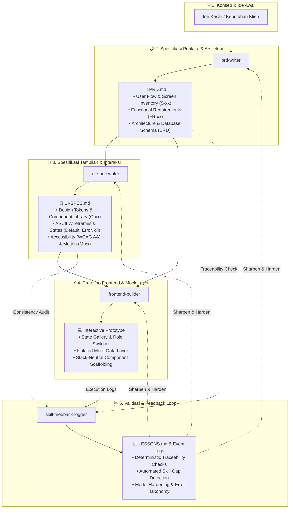

# 👻 Phantom Skills — Universal AI Agent Skills Suite

[](https://github.com/vercel-labs/agent-skills)
[](https://opensource.org/licenses/MIT)
[](#-koleksi-skills)
[](#-alur-kerja-spec-driven-development)
[](#)

**Phantom Skills** adalah kumpulan *custom skills* modular dan universal berstandar terbuka untuk berbagai **AI Code Agent** (Cursor, Claude Code, Windsurf, Cline, Roo Code, GitHub Copilot, Gemini CLI, dan Antigravity).

Phantom Skills menerapkan metodologi **Spec-Driven Development (SDD)**: mengubah ide kasar menjadi blueprint teknis yang presisi, desain antarmuka komprehensif, prototipe frontend yang dapat ditinjau (*clickable & reviewable*), hingga audit konsistensi deterministik dan penajaman kualitas skill berbasis bukti (*evidence-based feedback loop*).

Dengan pemisahan tegas antara **perilaku produk (*behavior*)**, **tampilan visual (*appearance/interaction*)**, **implementasi prototipe (*code execution*)**, dan **penjaminan kualitas (*validation & logging*)**, tim dan agen koding Anda dapat mengeksekusi proyek dengan akurasi tinggi tanpa halusinasi (*zero guesswork*).

---

## 🔄 Alur Kerja Spec-Driven Development



---

## 📦 Koleksi Skills

Repositori ini memuat 4 *skill* modular yang saling melengkapi dalam satu siklus pengembangan utuh, namun tetap dapat digunakan secara mandiri:

### 1. 📋 `prd-writer` — Universal PRD & Technical Spec
> **Fokus:** Menjadi *Single Source of Truth* untuk **perilaku, kebutuhan sistem, arsitektur, dan logika produk**.

* **Alur Clarify-then-Generate:** Menganalisis ide Anda dan mengajukan 3–5 pertanyaan tajam sesuai arketipe proyek (SaaS, Mobile, 3D/Motion Web, AI Agent, Game, CLI, Marketplace), atau langsung dieksekusi dengan opsi *"buat langsung"*.
* **Diagram Visual Otomatis (Mermaid):** Menghasilkan *User Flowchart*, *Architecture Diagram*, dan *Database ER Diagram* yang siap di-render di IDE, GitHub, maupun Notion.
* **Traceable & Stable IDs:** Setiap kebutuhan (`FR-xx`, `NFR-xx`), fitur (`F-xx`), dan layar (`S-xx`) memiliki identitas permanen untuk integrasi ke tahap desain dan koding.
* **Output:** Dokumen `PRD.md` 7 poin terstruktur lengkap dengan kriteria penerimaan terukur (*Given/When/Then*).

---

### 2. 🎨 `ui-spec-writer` — Developer & Designer-Ready UI Specification
> **Fokus:** Menjadi *Single Source of Truth* untuk **estetika, sistem desain, interaksi, dan spesifikasi layar per layar**.

* **Kontrak Ketat dengan PRD (Non-Destructive):** Bersifat *read-only* terhadap `PRD.md`. Tidak pernah mengubah logika bisnis di PRD secara sepihak; jika ada celah desain, dicatat dalam *PRD Change Requests*.
* **Arah Visual Anti-Generic:** Memandu arah visual unik berbasis domain industri, menjauh dari *AI template defaults* (*anti-generic checklist*).
* **Desain Sistem & Token Mandiri:** Mendefinisikan token warna (peran semantik), tipografi, spacing, radius, elevasi, serta pustaka komponen (`C-xx`) dengan varian dan status interaksi.
* **Spesifikasi Layar Komprehensif:** ASCII Wireframe responsif (mobile & desktop) dengan cakupan status lengkap (*default, loading, empty, error, success, offline*).
* **Aksesibilitas & Microcopy:** Standar kontras WCAG AA (4.5:1 / 3:1), target sentuh ≥44×44px, navigasi keyboard, serta kurasi teks tombol dan pesan error bernada aktif.
* **Output:** Dokumen `UI-SPEC.md` 11 bagian yang siap diserahkan langsung ke *frontend developer* atau *coding agent*.

---

### 3. ⚡ `frontend-builder` — Working & Reviewable Frontend Prototype
> **Fokus:** Mengubah `UI-SPEC.md` dan `PRD.md` menjadi **prototipe frontend fungsional dan dapat diklik (*clickable & reviewable*)** sebelum backend ada.

* **Stack-Neutral & Framework-Agnostic:** Mengikuti pilihan stack di PRD (Next.js, React, Vue, Svelte, Tailwind/Vanilla CSS, Flutter, dll) atau memilih default mainstream yang dicatat transparan di rencana rilis.
* **Lapisan Mock Data Terisolasi (*Isolated Mock Layer*):** Memodelkan skema entitas dari ERD dan endpoint PRD dalam satu lapisan mandiri lengkap dengan simulasi latensi jaringan dan saklar error (*error toggles*). Layar tidak pernah memanggil mock data mentah secara acak.
* **Perangkat Peninjauan Terintegrasi (*Review Tools*):**
  * **Role Switcher:** Panel khusus dev untuk beralih peran pengguna (*multi-role testing*) secara instan dengan data ter-seed.
  * **State Gallery:** Halaman katalog untuk meninjau setiap screen (`S-xx`) dalam seluruh status UI (*default, loading, empty, error, success*).
  * **Component Gallery:** Pustaka komponen interaktif untuk mengecek seluruh varian `C-xx`.
* **Traceability IDs di Kode:** Setiap file komponen, layar, dan token mencantumkan komentar ID spesifikasi (`S-01`, `C-02`, `F-03`) untuk mencegah desinkronisasi spesifikasi vs kode.
* **Output:** Aplikasi prototipe yang siap diuji non-developer, `BUILD-PLAN.md`, `REVIEW.md`, dan `CHANGE-REQUESTS.md` (jika ditemukan celah spesifikasi).

---

### 4. 🩺 `skill-feedback-logger` — Continuous Quality, Traceability & Model Hardening
> **Fokus:** Mencatat kesalahan, memvalidasi konsistensi antar-dokumen, dan **meningkatkan keandalan skill AI berbasis bukti nyata (*evidence-based*)**.

* **Taksonomi Kesalahan Komprehensif (18+ Kategori):** Mengklasifikasikan anomali seperti `hallucination`, `contract_violation`, `id_drift`, `scope_creep`, `spec_gap`, `missing_state`, `syntax_error`, dan `build_error`.
* **Skrip Validasi Deterministik (`check_traceability.py`):**
  * Memverifikasi keberadaan semua ID (`S-xx`, `F-xx`) di `UI-SPEC.md` dan kode terhadap `PRD.md`.
  * Memastikan cakupan fitur prioritas utama (P0) tidak terlewat.
  * Memvalidasi keseimbangan sintaks Mermaid dan mendeteksi warna hardcoded (*raw hex*) di luar file token.
* **Append-Only Logging (`log_event.py`):** Menyimpan riwayat kegagalan dan koreksi ke dalam `.skill-logs/events.md` secara aman tanpa memodifikasi dokumen proyek secara sepihak.
* **Retrospektif & Penajaman Model (`summarize_logs.py`):** Menganalisis pola kegagalan berulang untuk merumuskan `LESSONS.md` dan patch aturan prompt agar model AI yang lebih ringan/hemat sekalipun tetap stabil dan patuh aturan (*model hardening*).
* **Output:** Log kejadian terstruktur, laporan validasi konsistensi otomatis, dan rekomendasi perbaikan skill di `LESSONS.md`.

---

## 📑 Matriks Peran & Siklus Hidup Dokumen

| Aspek | `prd-writer` | `ui-spec-writer` | `frontend-builder` | `skill-feedback-logger` |
| :--- | :--- | :--- | :--- | :--- |
| **Fokus Utama** | Perilaku (*What it does & why*) | Tampilan & Rasa (*How it looks & feels*) | Prototipe Fungsional (*How it works & clicks*) | Audit & Kualitas (*How reliable & accurate*) |
| **Input Utama** | Ide kasar / kebutuhan user | Dokumen `PRD.md` | `UI-SPEC.md` + `PRD.md` | Artefak spesifikasi, kode, & log rilis |
| **Output Utama** | `PRD.md` | `UI-SPEC.md` | Prototipe UI, `REVIEW.md`, `BUILD-PLAN.md` | `.skill-logs/events.md`, `LESSONS.md` |
| **Identitas Elemen** | `FR-xx`, `NFR-xx`, `F-xx`, `S-xx` | Merujuk `F-xx` & `S-xx`, buat `C-xx` & `M-xx` | Menerapkan `S-xx`, `C-xx`, `F-xx` di kode | Memvalidasi integritas & mencegah ID drift |
| **Representasi** | Screen Inventory & User Flow | ASCII Wireframe & Sitemap | Layar Interaktif & Galeri Komponen | Laporan Traceability & Metrik Error |
| **Status / States** | Edge cases & validasi logika | 5+ Status UI (Default, Loading, dll) | Implementasi status + saklar simulasi | Audit kelengkapan status per layar |
| **Peran Terhadap Kode** | Kontrak logika bisnis | Kontrak visual & interaksi | Membangun struktur frontend & mock layer | Memastikan kode patuh pada spesifikasi |

---

## 🚀 Cara Instalasi

Anda dapat menginstal seluruh paket *skill* sekaligus atau memilih *skill* tertentu ke proyek maupun komputer Anda menggunakan CLI resmi `npx skills`:

### 1. Instal Seluruh Skill (Rekomendasi)
Pasang seluruh paket Phantom Skills ke folder proyek aktif Anda:

```bash
npx skills add https://github.com/chandrapratamalab/phantom-skill.git
```

### 2. Instal Skill Spesifik
Jika Anda hanya membutuhkan salah satu atau beberapa *skill*:

```bash
# PRD Writer (Spesifikasi Produk & Arsitektur)
npx skills add https://github.com/chandrapratamalab/phantom-skill.git --skill prd-writer

# UI Spec Writer (Spesifikasi Desain & Wireframe)
npx skills add https://github.com/chandrapratamalab/phantom-skill.git --skill ui-spec-writer

# Frontend Builder (Prototipe & Mock Layer)
npx skills add https://github.com/chandrapratamalab/phantom-skill.git --skill frontend-builder

# Skill Feedback Logger (Validasi QA & Audit Log)
npx skills add https://github.com/chandrapratamalab/phantom-skill.git --skill skill-feedback-logger
```

### 3. Instalasi Khusus Code Agent Tertentu
Gunakan flag `-a` untuk menargetkan agen spesifik:

```bash
# Contoh untuk Cursor dan Claude Code
npx skills add https://github.com/chandrapratamalab/phantom-skill.git -a cursor -a claude-code

# Contoh untuk Windsurf
npx skills add https://github.com/chandrapratamalab/phantom-skill.git -a windsurf
```

### 4. Instalasi Global (Aktif di Semua Proyek Komputer Anda)
Gunakan flag `-g` agar *skills* selalu tersedia di mana pun Anda membuka terminal:

```bash
npx skills add https://github.com/chandrapratamalab/phantom-skill.git -g
```

---

## 💻 Code Agent yang Didukung

| Code Agent | Direktori Instalasi Otomatis | Cara Memanggil / Menjalankan |
| :--- | :--- | :--- |
| **Cursor** | `.cursor/rules/` atau `.agents/skills/` | Otomatis via Chat atau sebut `@prd-writer`, `@ui-spec-writer`, `@frontend-builder`, `@skill-feedback-logger` |
| **Claude Code** | `.claude/skills/` | Otomatis terdeteksi atau panggil `/prd-writer`, `/ui-spec-writer`, `/frontend-builder`, `/skill-feedback-logger` |
| **Windsurf** | `.windsurf/rules/` atau `.agents/skills/` | Otomatis di Cascade saat merencanakan arsitektur, desain UI, prototyping, atau validasi QA |
| **Cline / Roo Code** | `.clinerules/` atau `.agents/skills/` | Otomatis aktif saat meminta pembuatan dokumen spec, koding frontend, atau evaluasi kesalahan |
| **GitHub Copilot** | `.github/skills/` | Otomatis aktif pada Copilot Chat & Edits |
| **Google Antigravity** | `.agents/skills/` atau `skills/` | Otomatis aktif sesuai konfigurasi *custom skills* |

---

## 🛠️ Panduan Penggunaan & Contoh Prompt

### Skenario A: Merancang Spesifikasi Produk (`prd-writer`)

Buka chat *agent* Anda dan berikan ide awal aplikasi:

> **Contoh Prompt 1 (SaaS / Web App):**
> *"Gunakan prd-writer untuk merancang aplikasi booking dan antrean barbershop berbasis web dengan notifikasi WhatsApp."*

> **Contoh Prompt 2 (3D Landing Page):**
> *"Buatkan PRD: Landing page interaktif 3D untuk brand jam tangan mewah menggunakan Three.js dan GSAP."*

**Respon Agen:**
Agen akan mengajukan 3–5 pertanyaan klarifikasi singkat (atau langsung menyusun dokumen jika Anda menambahkan instruksi *"buat langsung"*). Hasilnya berupa file `PRD.md` yang siap dieksekusi.

---

### Skenario B: Merancang Desain Antarmuka (`ui-spec-writer`)

Setelah `PRD.md` tersedia di *workspace*, minta agen merancang cetak biru antarmukanya:

> **Contoh Prompt 1:**
> *"Dari PRD.md yang ada, buatkan UI-SPEC.md lengkap dengan design system dan wireframe setiap screen."*

> **Contoh Prompt 2 (Instruksi Cepat):**
> *"Jalankan ui-spec-writer untuk PRD ini. Buat langsung dengan gaya modern, minimalis, dan dark mode."*

**Respon Agen:**
Agen membaca `PRD.md`, menyusun arah visual, menentukan token warna dan tipografi, menggambar diagram navigasi sitemap, merinci ASCII wireframe untuk setiap `S-xx`, serta menyiapkan status layar dan panduan aksesibilitas WCAG AA ke dalam file `UI-SPEC.md`.

---

### Skenario C: Membangun Prototipe Frontend Interaktif (`frontend-builder`)

Setelah memiliki `UI-SPEC.md` dan `PRD.md`, minta agen membangun antarmuka interaktif:

> **Contoh Prompt 1:**
> *"Berdasarkan PRD.md dan UI-SPEC.md, bangun prototipe frontend aplikasi ini. Siapkan mock data layer dan review tools untuk pengujian role pengguna."*

> **Contoh Prompt 2 (Fokus Fitur Prioritas):**
> *"Gunakan frontend-builder untuk mengeksekusi semua screen P0 terlebih dahulu. Pastikan state gallery dan role switcher berfungsi penuh."*

**Respon Agen:**
Agen menyusun `BUILD-PLAN.md`, membangun token dan pustaka komponen `C-xx`, menyiapkan isolasi mock data dari ERD/endpoint PRD, mengimplementasikan screen `S-xx` dengan semua state, serta melengkapi prototipe dengan panel Role Switcher dan State Gallery agar UX dapat langsung dievaluasi sebelum backend dibuat.

---

### Skenario D: Eksekusi Koding Terarah (*Targeted Coding*)

Setelah blueprint lengkap dan Anda ingin fokus pada modul tertentu:

> **Contoh Prompt:**
> *"Berdasarkan PRD.md (F-01) dan UI-SPEC.md (S-01, C-01), implementasikan komponen Header dan Hero Section lengkap dengan animasi dan responsiveness sesuai spesifikasi token."*

Agen Anda akan menulis kode dengan presisi tinggi tanpa perlu menebak warna hex, ukuran tombol, alur navigasi, maupun penanganan status error.

---

### Skenario E: Validasi Traceability & Siklus Evaluasi (`skill-feedback-logger`)

Jalankan pengujian konsistensi dan catat feedback untuk penajaman berkelanjutan:

> **Contoh Prompt 1 (Audit Traceability):**
> *"Gunakan skill-feedback-logger untuk memvalidasi traceability antara PRD.md, UI-SPEC.md, dan kode. Laporkan jika ada ID fiktif atau screen yang terlewat."*

> **Contoh Prompt 2 (Retrospektif & Model Hardening):**
> *"Analisis kesalahan dan koreksi yang tercatat selama pengerjaan proyek ini, lalu hasilkan LESSONS.md dengan usulan hardening pada aturan skill."*

**Respon Agen:**
Agen menjalankan skrip validator deterministik (`check_traceability.py`), mencatat setiap anomali ke `.skill-logs/events.md`, dan merangkum evaluasi untuk memperkuat instruksi skill agar tahan terhadap halusinasi model AI di masa depan.

---

## 📂 Struktur Repositori

```text
.
├── README.md
└── skills/
    ├── frontend-builder/
    │   ├── SKILL.md
    │   └── references/
    │       ├── build-order.md
    │       ├── mock-data-layer.md
    │       ├── review-tools.md
    │       └── stack-mapping.md
    ├── prd-writer/
    │   ├── SKILL.md
    │   └── references/
    │       ├── mermaid-rules.md
    │       ├── question-bank.md
    │       └── template.md
    ├── skill-feedback-logger/
    │   ├── SKILL.md
    │   ├── references/
    │   │   ├── analysis-playbook.md
    │   │   ├── model-hardening.md
    │   │   └── taxonomy.md
    │   └── scripts/
    │       ├── check_traceability.py
    │       ├── log_event.py
    │       └── summarize_logs.py
    └── ui-spec-writer/
        ├── SKILL.md
        └── references/
            ├── design-rules.md
            ├── mermaid-rules.md
            ├── question-bank.md
            └── template.md
```

---

## 📄 Lisensi

Didistribusikan di bawah **Lisensi MIT**. Bebas digunakan, dimodifikasi, dan dibagikan untuk proyek pribadi maupun komersial.