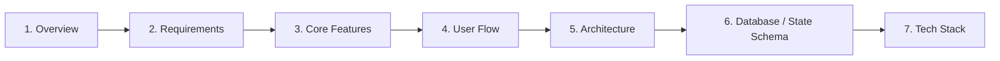

# 📋 PRD Writer — Universal AI Agent Skill

[](https://github.com/vercel-labs/agent-skills)
[](https://opensource.org/licenses/MIT)
[](#)

**`prd-writer`** adalah *custom skill* universal untuk berbagai **AI Code Agent** (Cursor, Claude Code, Windsurf, Cline, Roo Code, GitHub Copilot, dan Gemini CLI) yang mengubah ide proyek kasar menjadi dokumen **Product & Technical Requirements Document (`PRD.md`)** siap pakai melalui alur kerja interaktif 2 tahap.

Dirancang dengan arsitektur **Single-File Adaptive**, *skill* ini sangat hemat penggunaan token, otomatis mendeteksi konteks proyek (termasuk `AGENTS.md` dan `package.json`), serta menghasilkan diagram visual menggunakan **Mermaid**.

---

## ✨ Fitur Utama

* **🎯 Tanya-Jawab Kontekstual (2-Step Workflow):** Tidak langsung menebak secara buta. Agen akan menganalisis ide awal Anda dan mengajukan 4–5 pertanyaan tajam yang relevan dengan domain proyek sebelum menulis PRD.
* **🔄 Adaptif untuk Segala Jenis Proyek:** Otomatis menyesuaikan isi teknis baik untuk proyek **Interactive 3D & Motion Landing Page**, **Full-Stack SaaS**, **Mobile App**, **AI Agent/Bot**, **Game**, maupun **CLI Tool**.
* **📊 Diagram Visual Otomatis (Mermaid):** Menghasilkan *flowchart*, *sequence diagram*, dan *ERD* yang langsung ter-render secara visual di GitHub, Notion, Cursor, dan VS Code.
* **⚡ Hemat Token (*Zero Bloat*):** Dikemas dalam satu file `SKILL.md` yang padat dan terstruktur tanpa membebani *context window* agen.
* **🤝 Terintegrasi dengan `AGENTS.md`:** Otomatis memeriksa file konfigurasi proyek yang sudah ada agar rekomendasi arsitektur dan *tech stack* tidak bentrok dengan *setup* Anda.

---

## 🚀 Cara Instalasi

Anda dapat menginstal *skill* ini langsung ke proyek maupun secara global menggunakan CLI `npx skills`:

### 1. Instalasi Standar (Per Proyek)
Jalankan perintah berikut di terminal folder proyek Anda:

```bash
npx skills add USERNAME_ANDA/NAMA_REPO_ANDA --skill prd-writer
```

### 2. Instalasi untuk Code Agent Tertentu
Gunakan flag `-a` jika Anda ingin memasangnya khusus ke agen spesifik (misalnya Cursor dan Claude Code):

```bash
npx skills add USERNAME_ANDA/NAMA_REPO_ANDA --skill prd-writer -a cursor -a claude-code
```

### 3. Instalasi Global (Tersedia di Semua Proyek)
Gunakan flag `-g` agar `prd-writer` selalu aktif di seluruh proyek komputer Anda:

```bash
npx skills add USERNAME_ANDA/NAMA_REPO_ANDA --skill prd-writer -g
```

---

## 💻 Code Agent yang Didukung

| Code Agent | Direktori Instalasi Otomatis | Cara Memanggil |
| :--- | :--- | :--- |
| **Cursor** | `.cursor/rules/` atau `.agents/skills/prd-writer/` | Otomatis via Chat atau ketik `@prd-writer` |
| **Claude Code** | `.claude/skills/prd-writer/SKILL.md` | Otomatis atau ketik `/prd-writer` |
| **Windsurf** | `.windsurf/rules/` atau `.agents/skills/prd-writer/` | Otomatis di Cascade saat merencanakan aplikasi |
| **Cline / Roo Code** | `.clinerules/` atau `.agents/skills/prd-writer/` | Otomatis aktif saat meminta pembuatan PRD |
| **GitHub Copilot** | `.github/skills/prd-writer/` | Aktif di Copilot Chat & Edits |

---

## 🛠️ Cara Penggunaan & Alur Kerja

### Tahap 1: Ketik Ide Awal Anda di Chat Agent
Buka *code agent* favorit Anda dan ketikkan ide proyek dalam satu kalimat sederhana:

> **Contoh Prompt 1 (Frontend 3D & Motion):**
> *"Buatkan PRD: Saya mau bikin landing page keren dengan HTML, CSS, dan JavaScript full animation 3D dan motion page keren."*

> **Contoh Prompt 2 (SaaS / Web App):**
> *"Gunakan prd-writer untuk merancang aplikasi booking dan manajemen antrean barbershop berbasis web yang terintegrasi dengan notifikasi WhatsApp."*

### Tahap 2: Jawab Pertanyaan Klarifikasi Singkat
Agen akan menganalisis *prompt* Anda dan memberikan 4–5 pertanyaan spesifik beserta contoh opsinya:
* Untuk **Landing Page 3D**, agen akan menanyakan tujuan konversi (CTA), jenis interaksi objek 3D saat *scroll*, gaya *motion*, pilihan *library* (Three.js/GSAP/Vanilla), serta *fallback* untuk HP spesifikasi rendah.
* Untuk **Aplikasi Barbershop**, agen akan menanyakan peran pengguna (pelanggan/kapster/kasir), sistem deposit pembayaran, dan aturan jadwal antrean.
* *(Tips: Anda juga bisa mengetik **"buat langsung"** jika ingin agen memilihkan opsi terbaik secara otomatis).*

### Tahap 3: Dokumen `PRD.md` Siap Dieksekusi
Agen akan langsung membuat file `PRD.md` di dalam *workspace* proyek Anda dan menawarkan untuk mulai menulis kodenya.

---

## 📑 Struktur 7 Poin `PRD-Project` yang Dihasilkan

Setiap dokumen PRD yang dihasilkan memiliki struktur standar yang siap dieksekusi oleh *developer* maupun *AI coding assistant*:



1. **Overview:** Ringkasan produk, *User Personas*, serta target metrik keberhasilan (KPI).
2. **Requirements:** *Functional Requirements*, *Non-Functional Requirements* (performa, FPS, keamanan), dan *Out of Scope* (batasan fase 1).
3. **Core Features:** Skala prioritas (P0/P1/P2), *User Stories*, *Acceptance Criteria* yang terukur, serta penanganan *Edge Cases & Error States*.
4. **User Flow:** Urutan perjalanan pengguna langkah demi langkah yang dilengkapi diagram visual **Mermaid Flowchart**.
5. **Architecture:** Struktur direktori proyek, interaksi antar-modul/API, serta diagram **Mermaid Architecture**.
6. **Database Schema (Adaptif):**
   * *Proyek Full-Stack/Backend:* Skema tabel lengkap (PK/FK, tipe data, relasi) + **Mermaid ER Diagram**.
   * *Proyek Frontend/3D/CLI:* Skema konfigurasi *State*, struktur JSON, dan *Asset Manifest*.
7. **Tech Stack:** Rekomendasi teknologi paling optimal beserta alasan teknis pemilihannya.

---

## 📂 Struktur Repositori

```text
.
├── README.md
└── skills/
    └── prd-writer/
        └── SKILL.md
```

---

## 📄 Lisensi

Didistribusikan di bawah Lisensi MIT. Bebas digunakan, dimodifikasi, dan dibagikan untuk proyek pribadi maupun komersial.