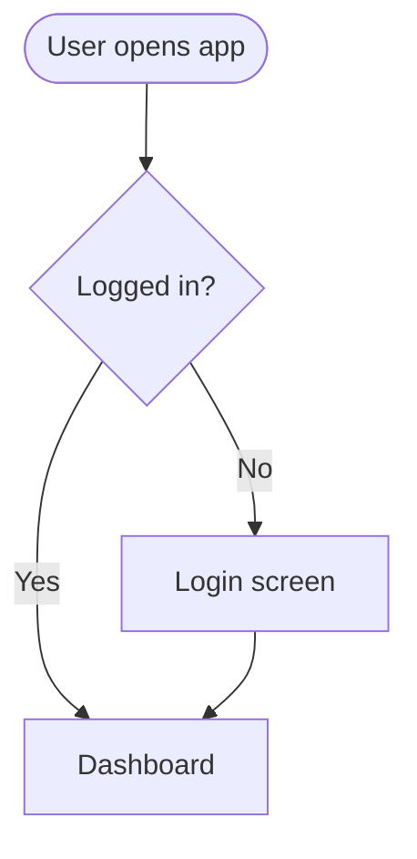
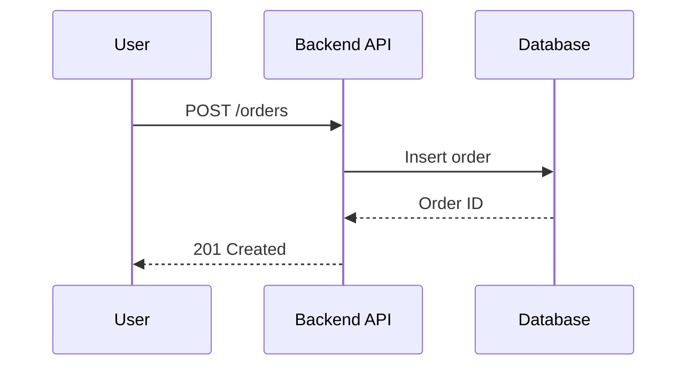
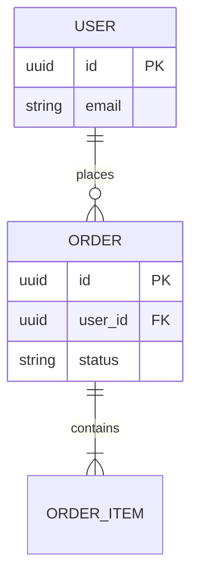

# Mermaid Syntax Rules

Broken diagrams are the most common failure in generated PRDs. Follow these rules for every diagram.

## General
1. Start with a valid diagram type: `flowchart TD`, `sequenceDiagram`, `erDiagram`, `stateDiagram-v2`.
2. Keep each diagram to ~15 nodes or fewer. Split large flows into several diagrams (e.g., "Registration flow", "Checkout flow").
3. Node IDs: letters, digits, underscore only, no spaces or special characters (`user_login`, not `user-login (v2)`).
4. **Wrap every label in double quotes** if it has spaces, parentheses, slashes, colons, commas, or non-ASCII characters: `A["Login (OAuth)"]`.
5. Do not use reserved words as IDs: `end`, `graph`, `subgraph`, `class`, `style`. Use `end_node` instead.
6. Never put raw `"` inside a label; use single quotes or rephrase.
7. One statement per line.

## flowchart

- Decisions use `{ }`, start/end use `([ ])`, processes use `[ ]`.
- Always label decision branches (`-- "Yes" -->`).
- Include at least one failure/edge path in user flows.

## sequenceDiagram

- Declare participants explicitly with short aliases.
- `->>` for requests, `-->>` for responses.

## erDiagram

- Entity names UPPER_SNAKE_CASE, singular, no spaces.
- Attribute format: `type name [PK|FK]`. No commas or parentheses in types (use `string`, `int`, `uuid`, `datetime`, `decimal`, `boolean`, `json`).
- Relationship labels are single words or snake_case, unquoted lowercase words are safest.
- Cardinality: `||--||` one-to-one, `||--o{` one-to-many, `}o--o{` many-to-many.

## Final check
Re-read each diagram once: balanced quotes, no unquoted special characters, every referenced node ID is defined or implicitly created, and every feature shown matches Sections 3 and 5.